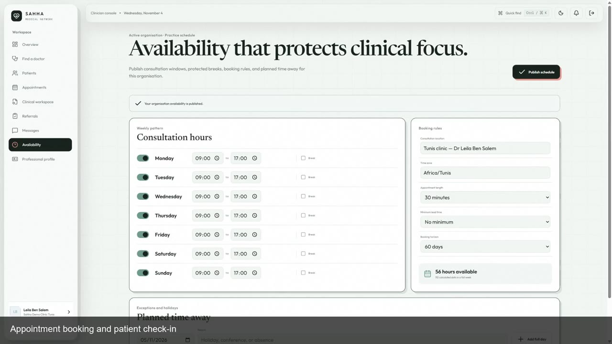
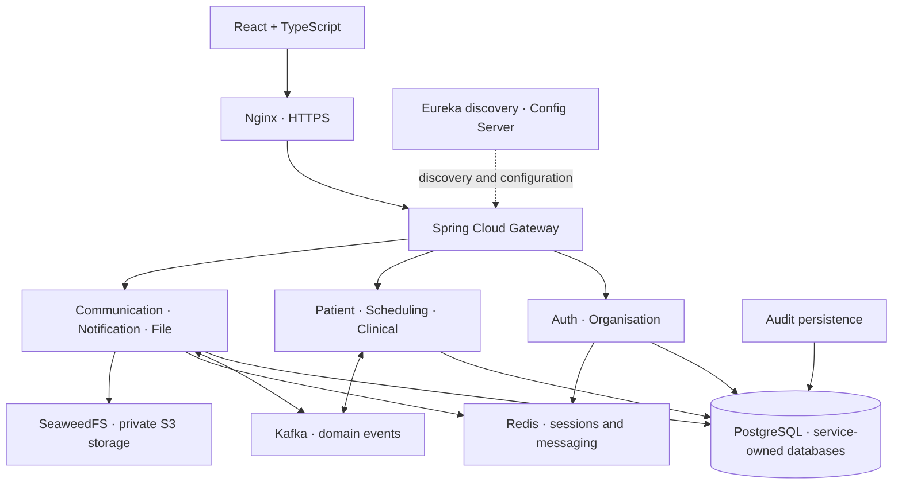

# Sahha

### Healthcare workflows. Connected care. Controlled access.

Sahha brings clinic administration, appointments, clinical records and doctor
collaboration into one application. Built as an engineering internship project,
it follows the patient journey from reception to consultation and a second
opinion, with explicit boundaries around who can see each record.

**Java 21 · Spring Boot · Spring Cloud · React · TypeScript · PostgreSQL · Kafka · Azure**

[Open the live application](https://sahha-demo-fares.spaincentral.cloudapp.azure.com)
&nbsp;·&nbsp; [Watch the English demo](docs/media/sahha-demo-en.mp4)
&nbsp;·&nbsp; [Voir la démo en français](docs/media/sahha-demo-fr.mp4)

[](docs/media/sahha-demo-en.mp4)

Both captioned walkthroughs run for **4 minutes** at a slower pace for easier
viewing. They show the deployed application using synthetic accounts and patient
data. [Demo guide and chapter timings →](docs/DEMO.md)

## Why Sahha?

A clinic's administrative work and its clinical work are closely connected, but
they require different access. Reception needs to organise a visit; a doctor
needs the relevant clinical history; another doctor may need only one selected
diagnosis for a second opinion.

Sahha connects those workflows through organisation-scoped roles, service-owned
data and explicit, revocable sharing.

## One application, five user roles

| Role | Main workflow |
| --- | --- |
| Platform administrator | Create healthcare organisations and assign their administrators. |
| Organisation administrator | Configure departments and manage staff memberships and invitations. |
| Receptionist | Register patients, check duplicates, book visits and manage check-in. |
| Doctor | Publish availability, conduct consultations, message colleagues and manage referrals. |
| Patient | Verify an account, connect a clinic registration, find doctors and track appointments. |

A single identity can belong to several organisations. Each action is checked
against the active organisation, current membership and the requested resource.

## The patient journey

1. **Prepare the clinic** — create the organisation, departments and staff.
2. **Arrange the visit** — publish availability, register the patient, request
   and confirm an appointment, then check the patient in.
3. **Document care** — record the consultation, diagnosis and treatment;
   finalisation locks the record and corrections remain attributable.
4. **Collaborate with consent** — message another doctor and share selected
   information through a referral with an explicit scope.
5. **Control access over time** — accept, revoke or expire the sharing grant;
   protected reads follow the current access decision.

Private file uploads, in-app notifications and a limited patient portal support
the same journey.

## Architecture

The repository contains the React frontend and **12 independently runnable
Spring Boot applications**. The browser uses the API Gateway; each stateful
service owns its PostgreSQL database and migrations.



| Layer | Technologies and responsibilities |
| --- | --- |
| Frontend | React, TypeScript, Vite, React Router and TanStack Query |
| Backend | Java 21, Spring Boot, Spring Security and Spring Cloud |
| Persistence | PostgreSQL, Flyway and independent service credentials |
| Events and live updates | Kafka and WebSocket notifications |
| Cache and storage | Redis and SeaweedFS with an S3-compatible API |
| Delivery | Azure Pipelines, an Ubuntu Azure VM, systemd, Nginx and Let's Encrypt |

The deployed application runs as native Java services on a single demonstration
VM. The pipeline tests and builds both frontend and backend, packages a checked
release, and activates it through the VM deployment agent.

## Security by design

- **Organisation and resource checks:** a role alone does not grant access to
  every patient record.
- **Session-aware authentication:** JWT validation is combined with an
  Auth-owned session decision; browser state-changing requests use CSRF protection.
- **Clinical boundaries:** administrative membership and private messaging do
  not grant clinical access.
- **Explicit sharing:** referrals record consent and scope; revocation and expiry
  remove shared access.
- **Private documents:** file reads require authorisation and scan-state checks;
  download access is short lived.
- **Traceable records:** finalised clinical records are immutable, with
  attributable corrections and service-local audit records.

[Session security](docs/SESSION_SECURITY.md) ·
[Permission model](docs/BACKEND_PERMISSIONS.md) ·
[Health and readiness](docs/HEALTH_READINESS.md)

## Explore the live demo

Open **[Sahha](https://sahha-demo-fares.spaincentral.cloudapp.azure.com)** or watch
the [English](docs/media/sahha-demo-en.mp4) /
[French](docs/media/sahha-demo-fr.mp4) walkthrough.

Public signup creates a patient login and requires email verification. Booking
also requires a clinic patient registration connected with clinic-issued details.
Staff and administrator roles are assigned through the organisation workflow.
The video shows those role-specific journeys without publishing credentials.

## Run locally

The native development workflow uses Java 21, Node.js/npm, PostgreSQL,
Redis-compatible caching, Kafka and SeaweedFS. Start with the
[native setup guide](docs/NATIVE_DEVELOPMENT.md) to configure the service-owned
databases and private environment files.

From the repository root, in PowerShell:

```powershell
node scripts/sahha.mjs check
node scripts/sahha.mjs build backend
node scripts/sahha.mjs start all
node scripts/sahha.mjs status
```

In another terminal:

```powershell
Set-Location frontend
npm ci
npm run dev
```

The local API Gateway listens on `8079`. Stop launcher-owned backend processes
with `node scripts/sahha.mjs stop`. The runner does not install infrastructure
or reset databases.

For an isolated, repeatable demonstration environment, follow the
[synthetic bootstrap guide](docs/SYNTHETIC_BOOTSTRAP.md).

## Validation

With the documented local test prerequisites configured:

```powershell
node scripts/sahha.mjs test tools
node scripts/sahha.mjs test backend
node scripts/sahha.mjs test frontend
node scripts/sahha.mjs build frontend
```

Backend tests cover domain rules, persistence and access boundaries. Frontend
tests cover the integrated role workflows and error states. The cloud
walkthrough records real browser interactions against the deployed Gateway.

## Repository map

| Path | Responsibility |
| --- | --- |
| `frontend/` | Browser application |
| `api-gateway/`, `auth-service/` | Public API entry point and identity |
| `organisation-service/`, `patient-service/` | Clinic structure and administrative patient registry |
| `scheduling-service/`, `clinical-service/` | Appointments and clinical records |
| `communication-service/`, `notification-service/` | Messaging, referrals, sharing and notifications |
| `file-service/`, `audit-service/` | Private files and audit persistence foundation |
| `discovery-server/`, `config-server/` | Service discovery and configuration |
| `session-security/` | Shared session and permission support |
| `scripts/` | Native development, validation and release tooling |
| `docs/` | Architecture decisions, setup guides and demonstrations |

## Further reading

- [Project context and V1 scope](docs/PROJECT_CONTEXT.md)
- [Backend package structure](docs/BACKEND_PACKAGE_STRUCTURE.md)
- [Gateway authentication flow](docs/GATEWAY_AUTH_GUIDE.md)
- [Frontend authentication guide](docs/FRONTEND_AUTH_GUIDE.md)
- [Demonstration videos](docs/DEMO.md)
- [Implementation and verification history](docs/INTERNSHIP_PLAN.md)

Developed by **[Mohamed Fares Jebali](https://github.com/faresjebal)**.
