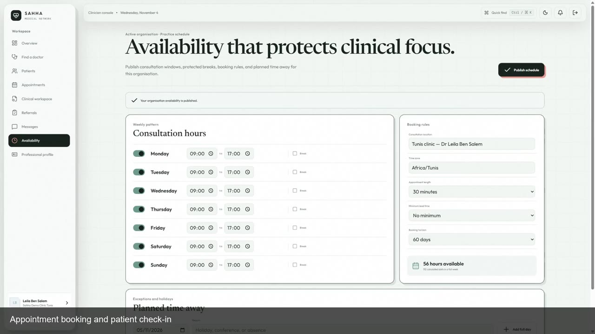

# Sahha application demonstration

The videos show the deployed Sahha application with synthetic identities and
patient data. They include all five V1 user roles: platform administrator,
organisation administrator, receptionist, doctor and patient.

| Language | Video | Duration |
| --- | --- | --- |
| English | [Download the MP4](https://github.com/faresjebal/sahha_backend/raw/refs/heads/feature/organisation-service/docs/media/sahha-demo-en.mp4) | 4 minutes |
| Français | [Télécharger le MP4](https://github.com/faresjebal/sahha_backend/raw/refs/heads/feature/organisation-service/docs/media/sahha-demo-fr.mp4) | 4 minutes |

These are the finished presentation edits slowed to half speed for readability.
Each is H.264, 1920 × 1080, 25 fps, with on-screen captions. Use the direct links above to download and play the MP4 locally. If you clone
the repository, the files are available directly under `docs/media/`.

## Chapters

| Starts at | Workflow |
| --- | --- |
| 00:00 | Organisation administration and clinic setup |
| 00:24 | Doctor availability, booking and patient check-in |
| 01:20 | Structured consultation and finalisation |
| 01:56 | Private doctor messaging |
| 02:20 | Selected-information referral and second opinion |
| 03:00 | Sharing revocation and protected access boundaries |
| 03:36 | Patient self-service and appointment status |

The speaking edit concentrates on the administrative, clinical, collaboration
and patient workflows. Source recordings and technical capture receipts are
retained separately; the videos do not establish complete production acceptance.

## Media provenance

These are unchanged copies of the finished slower English and French videos,
derived from the recorded cloud walkthrough. The preview is a frame from the
English video at 00:38.

| File | SHA-256 |
| --- | --- |
| `media/sahha-demo-en.mp4` | `b32eb8b362ef4c1670aa2facab9616742c32ba1bb891e9287ee40e1a7ba5e746` |
| `media/sahha-demo-fr.mp4` | `52ced1d3451f6cfc9c269bcbbd5c068167ec2c9634965aac7f28317765c645e7` |

No account password, session token or private configuration is included.
